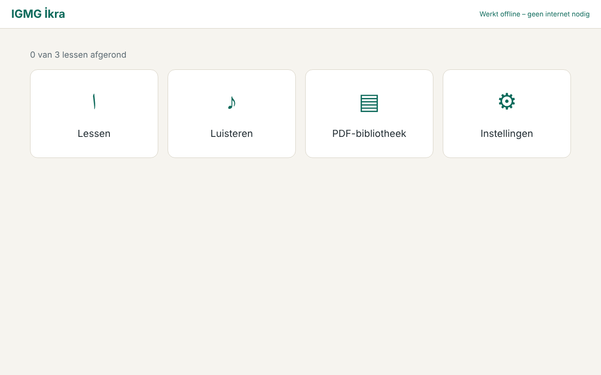

# IGMG İkra – offline lesapp

Desktopapp (Electron + React) voor docenten en leerlingen. Ze werkt **volledig offline**.
Na installatie heb je geen internet, wifi, server of account nodig.



> ⚠️ **Demo-inhoud.** De lessen, audio (testtonen), "Luisteren"-fragmenten en de PDF zijn
> voorbeeldbestanden. Ze zijn in de app gemarkeerd met een gele balk. Vervang ze door
> goedgekeurde IGMG-inhoud voordat de app in gebruik gaat (zie [Inhoud vervangen](#inhoud-vervangen)).
> Er staat bewust **geen** Qur'an-tekst of recitatie in deze repository.

## Wat de app kan

| Onderdeel | Inhoud |
|---|---|
| Start | Taal kiezen bij de eerste start: Türkçe, Nederlands of Deutsch |
| Lessen | Lescatalogus met per les een **docentmodus** (letter groot op het bord, audio, notitie) en een **leerlingmodus** (oefenvragen met score) |
| Luisteren | Arabische tekst met lokale audio, herhalen en snelheid |
| PDF-bibliotheek | Lokale PDF's: bladeren, zoomen, tekenen met pen/markeerstift (ook met vinger op een smartboard) |
| Instellingen | Taal, grootte van de Arabische tekst, waar de gegevens staan |

Bediening met het toetsenbord: `←` `→` bladeren, `spatie` afspelen, `1`–`4` antwoord kiezen,
`Esc` terug, `F11` volledig scherm.

## Zo werkt "offline"

- Alles wat de app nodig heeft (code, lettertype Amiri, PDF-lezer, audio, PDF's) zit **in het
  installatiebestand**. Er wordt niets van internet geladen.
- De app laadt haar bestanden via een intern adres (`app://ikra/`), niet via een server.
- **Elk netwerkverzoek wordt geblokkeerd**, op twee niveaus: een strikte beveiligingsregel
  in de pagina (CSP) en een blokkade in Electron zelf.
- Geen login, geen updatecheck, geen statistieken, geen cloud.

## Gegevens van gebruikers

Instellingen en voortgang staan alleen op de computer, in één bestand:

| Systeem | Locatie |
|---|---|
| Windows | `%APPDATA%\IGMG Ikra\ikra-data.json` |
| Linux | `~/.config/IGMG Ikra/ikra-data.json` |

Het exacte pad staat ook onder **Instellingen** in de app.

- **Back-up maken:** kopieer dat bestand.
- Bij elke wijziging bewaart de app de vorige versie als `ikra-data.json.bak`.
- Is het bestand beschadigd? Dan gebruikt de app de backup en bewaart ze het kapotte bestand
  als `ikra-data.json.corrupt-…`. Er wordt nooit iets stilzwijgend weggegooid.

## Voor ontwikkelaars

Vereist: Node.js 22 of nieuwer.

```bash
npm install          # eenmalig
npm run start        # bouwen en de desktopapp starten
npm test             # unit-tests (Vitest)
npm run typecheck    # TypeScript-controle
npm run test:e2e     # bouwt en test de echte desktopapp (Playwright)
npm run dist:linux   # maakt release/IGMG Ikra-<versie>.AppImage
```

- Draai je als root in een container? Zet dan `IKRA_TEST_NO_SANDBOX=1` voor de e2e-tests.
  Gebruik ook `xvfb-run -a` als er geen scherm is.
- `IKRA_EXECUTABLE=<pad>` test een gebouwde app (bijvoorbeeld de AppImage) in plaats van de lokale build.
- Tests gebruiken altijd een **tijdelijk, apart profiel** (`IKRA_USER_DATA_DIR`). Echte gegevens
  worden nooit aangeraakt.
- Een Windows-installer is ingesteld (`electron-builder --win`), maar nog **niet gebouwd of
  getest**. Bouw die op een Windows-machine.

### Mappen

```
electron/        hoofdproces: venster, app://-protocol, netwerkblokkade, lokale opslag
src/             de schermen (React) en vertalingen (src/i18n.ts)
src/content/     lessen, letters, luisterfragmenten, PDF-lijst (JSON)
public/content/  audio en PDF's (worden meegeleverd in de app)
scripts/         demo-bestanden maken, schermafbeeldingen
tests/e2e/       eind-tot-eindtests van de desktopapp
```

## Inhoud vervangen

1. **Lessen:** bewerk `src/content/lessons.json` (titels in `tr`/`nl`/`de`, en welke letters erbij horen).
2. **Audio per letter:** zet bestanden in `public/content/audio/`. De naamgeving staat in
   `letterAudio()` in `src/lib/content.ts`.
3. **Luisteren:** bewerk `src/content/listening.json`. Zet `"audio": null` als er geen opname is.
4. **PDF's:** zet ze in `public/content/pdf/` en voeg ze toe aan `src/content/pdfs.json`.
5. Haal `"demo": true` weg zodra de inhoud echt en goedgekeurd is. Dan verdwijnt de gele balk.
6. Draai `npm test`. Die test controleert onder andere dat elk genoemd bestand echt bestaat
   en dat elke titel in alle drie de talen is ingevuld.

Neem alleen inhoud op waarvan de gebruiksrechten bevestigd zijn.

## Meegeleverde onderdelen van derden

- [Amiri](https://github.com/aliftype/amiri) lettertype – SIL Open Font License 1.1
- [PDF.js](https://github.com/mozilla/pdf.js) – Apache License 2.0
- [React](https://react.dev) – MIT
- [Electron](https://www.electronjs.org) – MIT
